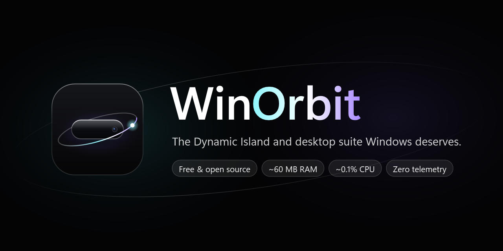
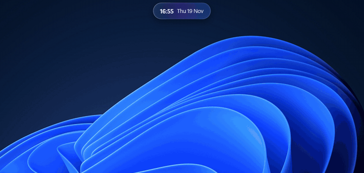
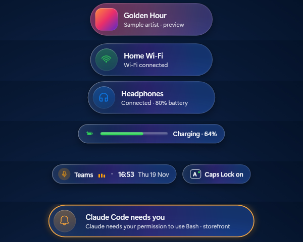
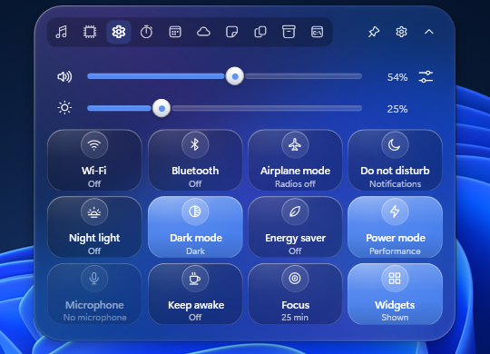
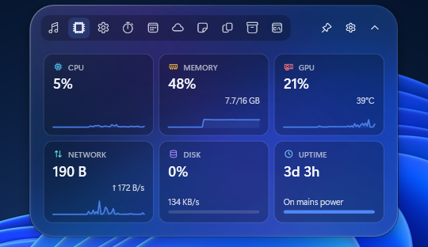
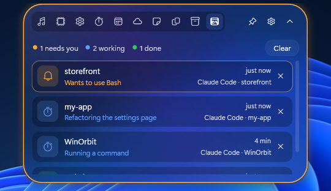
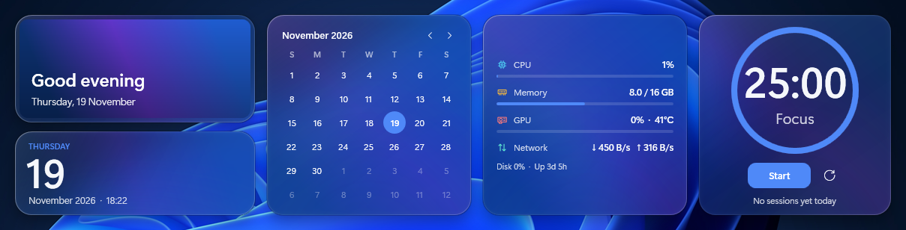

<p align="center">
  
</p>

<p align="center">
  <b>A Dynamic Island, a Control Centre, widgets, a launcher and liquid-glass theming — in one free, private, featherweight app for Windows 10 &amp; 11.</b>
</p>

<p align="center">
  <a href="../../releases/latest"><b>⬇ Download the latest release</b></a> ·
  <a href="docs/USER-GUIDE.md">User guide</a> ·
  <a href="docs/PRIVACY.md">Privacy audit</a> ·
  <a href="docs/ROADMAP.md">Roadmap</a>
</p>

<p align="center">
  
  
  
  
</p>

<p align="center">
  
</p>

---

## Why WinOrbit

People stack half a dozen tools to make Windows feel modern — a Dynamic Island app, Rainmeter, a volume-flyout replacement, a clipboard manager, a launcher, a night-light toggle. WinOrbit replaces them with **one** native app:

* **Featherweight.** About 80 MB of RAM in use and under 0.1 % CPU at idle, measured over five minutes ([test report](docs/TEST-REPORT.md)). Native WPF on .NET 8 — no Electron, no WebView, **no third-party packages**. Almost everything is event-driven: Windows tells WinOrbit when something changes. The small exceptions: the lock-key alert checks three key lights about eight times a second, and — only if you have more than one keyboard — the keyboard-language card checks which keyboard is in use four times a second.
* **Private by design.** No telemetry, analytics, accounts or automatic update checks. **Zero network connections by default**; the two optional online features (weather, synced lyrics) have their own switches, "Check for updates" only runs when you click it, and every request is shown in a ledger.
* **Free forever.** Open source under GPL-3.0 — every copy and fork has to stay free and open.
* **No admin rights, no hacks.** Per-user install. No DLL injection, no system-file patching, nothing that weakens Windows security.

## What you get

### 🏝️ Dynamic Island
A liquid-glass capsule at the top of your screen that comes alive:
* **Now playing** with album art, an equaliser that moves with the real audio (tinted by the cover), a **seek bar** and ±10 s — Spotify, YouTube in Chrome/Brave/Edge, Apple Music, Media Player, and classic players like **VLC, foobar2000, Winamp, PotPlayer, MPC and mpv**.
* **Synced lyrics** (opt-in) — the line being sung, right in the capsule.
* **Live activities** — volume and brightness meter, a green **charging** animation, low-battery warnings, Energy Saver, focus timer, downloads, **screenshots** (a thumbnail card you can click to open or drag straight into a chat), **Caps / Num / Scroll Lock**, the **keyboard language** switching, **Wi-Fi and Ethernet** connecting and dropping, the **Wi-Fi and Bluetooth radios** switching on or off, **dark / light mode**, **night light**, **airplane mode**, **Energy Saver**, **Bluetooth** devices (with their battery level, when the device reports it) and **USB** devices coming and going. Connections and radios open as a larger card (icon tile, name, state, and a switch that flips while you watch), and they arrive within a moment of the change.
* **Liquid motion** — the island moves on real spring physics: it bounces open, squashes when pressed, bulges like a droplet when something new arrives, and can be redirected mid-motion without a jolt. Optional coloured rims (Prism, Aurora, Sunset, Ocean, Mono, Accent) with a soft glow. Reduced Motion turns all of it off.
* **Shapes** — Capsule, Rounded, Square, Notch (flush with the top of the screen, like a camera notch) or Drop, in Slim, Regular or Tall; every shape morphs on the same springs.
* **Album colours** — while a song plays, the glass glows with its artwork's colours and cross-fades when the track changes; a new song opens a card with the cover, title and artist. An "Album" rim uses the same colours.
* **Privacy dots** — 🟠 microphone, 🟢 camera, 🔵 location in use, with the app's name. Your security, at a glance.
* **Control Centre** — 12 liquid-glass tiles that switch the real setting: Wi-Fi, Bluetooth, Night light, Dark mode, Power mode, Microphone, Keep awake, Focus, Widgets, plus Airplane mode, Do not disturb and Energy saver shortcuts; volume and monitor brightness sliders, and **volume by app** — a slider and mute for each app playing sound — plus a one-click **output device** switch (speakers, headphones, HDMI).
* **Clipboard history** (opt-in, memory-only, skips password-manager copies) and a **file shelf** — drop files on the island, drag them out later.
* **Calendar with events** — pick a day, type "9:30 Stand-up" and press Enter; the island grows into a reminder card ten minutes before and when it starts. Import your Google or Outlook calendar from an `.ics` file, repeating events included. Events stay on this PC.
* **Side bubble** — while the capsule shows music, a call, a timer or a download, short alerts (Caps Lock, keyboard language, "copied") split off into a small bubble beside it instead of replacing it.
* **Microphone pill** — during a call, the app's name, a live level and Windows' own mute button.
* **Coding agents** (opt-in) — an Agents tab showing what Claude Code, Codex or your own tools are doing; the island keeps an orange rim while a session waits for your OK and turns green for a moment when one finishes. Uses the tools' own hooks, which you paste in yourself.
* **Cards from your scripts** (opt-in) — a local pipe, open only to your own Windows account, that lets your scripts show "Build finished" or "Backup done".
* **Weather** (optional, off until you turn it on) — now, the next twelve hours and three days, while the glass takes on the sky's colours: blue on a clear day, slate in rain, indigo at night.
* Quick notes, system monitor. Drag it anywhere — it clicks into the exact centre.
* **Any screen edge** — top, bottom (just above the taskbar) or either side; it opens away from its edge, and a notch or drop shape turns to face it. Drag it right up to another edge to move it there.
* **Out of the way** — hides within about a tenth of a second when a game, video or presentation goes fullscreen, and drops back in after. Choose apps it keeps showing over, and apps it always hides for even in a window.

<table>
  <tr>
    <td width="50%"></td>
    <td width="50%"></td>
  </tr>
  <tr>
    <td align="center"><sub>Live activities and the side bubble</sub></td>
    <td align="center"><sub>Control Centre</sub></td>
  </tr>
  <tr>
    <td></td>
    <td></td>
  </tr>
  <tr>
    <td align="center"><sub>System monitor</sub></td>
    <td align="center"><sub>Coding agents (opt-in)</sub></td>
  </tr>
</table>

<sub>Taken from WinOrbit's built-in previews (Settings › Dynamic Island › Preview) on the default Windows 11 wallpaper; the song is a sample.</sub>

### 🔎 Launcher — <kbd>Alt</kbd>+<kbd>Space</kbd>
Apps (desktop and Store, with icons), Windows and WinOrbit settings, actions (dark mode, lock, focus, profiles…), recent files, a calculator (`12*7`, `200*15%`), unit conversion (`10 km to mi`), timers (`timer 5 min`, `focus 50`, `stopwatch`) that count down in the island, reminders (`remind me in 20 min to stretch`, `remind me at 6pm to call mom`), world time (`time in Tokyo`, offline) and your clipboard history (`clip invoice`). Learns your favourites — on your PC only.

### 🧊 Liquid-glass desktop
* **Wallpaper-aware glass** that frosts your real wallpaper — including **Wallpaper Engine / Lively** live wallpapers. Optional **Live glass** (Windows 11) shows the windows behind it instead, and **curved edges** bend the light at the rim. Island materials: Glass, Smoked, Solid or **Black**.
* **13 widgets** — clocks, calendar, world clock, system monitor, now playing, focus, notes, tasks, launcher, recycle bin, weather and more; drag, snap, resize.
* **10 themes**, a live **Liquid Glass Editor**, dark / light / auto / scheduled modes, wallpaper-generated gradients.
* **Profiles** (Study, Gaming, Productivity, Minimal, Night) with optional automation.
* **Windows tweaks** with full backup and one-click **Revert all**.
* **Rainmeter manager** — appears only if you use Rainmeter.

<p align="center">
  
  <br><sub>A few of the widgets: ambient card, clock, calendar, system monitor and focus timer</sub>
</p>

## Install

Grab the files from the **[latest release](../../releases/latest)**:

| File | For |
|---|---|
| `WinOrbit-Setup-<version>.exe` | Recommended. Installs for your user only — **no admin prompt**. Needs the [.NET 8 Desktop Runtime](https://dotnet.microsoft.com/download/dotnet/8.0) (setup checks and links it). |
| `WinOrbit-Portable-<version>-win-x64.zip` | No install, no runtime needed. Unzip anywhere and run `WinOrbit.exe`; settings stay next to it. |

> **SmartScreen:** WinOrbit isn't code-signed (certificates cost money), so Windows may say *"Windows protected your PC"*. Click **More info → Run anyway**. Every release lists SHA-256 checksums, and the source is right here. WinOrbit is applying for free open-source code signing: see the [code signing policy](CODE_SIGNING_POLICY.md).

Upgrading from an earlier build called *Glasswave* keeps all your settings.

## Shortcuts

| Keys | Does |
|---|---|
| <kbd>Alt</kbd>+<kbd>Space</kbd> | Launcher (falls back to <kbd>Win</kbd>+<kbd>Alt</kbd>+<kbd>Space</kbd> if another app owns it) |
| <kbd>Ctrl</kbd>+<kbd>Alt</kbd>+<kbd>Space</kbd> | Open the island with the keyboard (falls back to <kbd>Ctrl</kbd>+<kbd>Alt</kbd>+<kbd>I</kbd>) |
| <kbd>Ctrl</kbd>+<kbd>Alt</kbd>+<kbd>W</kbd> / <kbd>Ctrl</kbd>+<kbd>Alt</kbd>+<kbd>G</kbd> | Show/hide widgets · open WinOrbit |
| <kbd>Ctrl</kbd>+<kbd>F</kbd> (in WinOrbit) | Search settings |

All changeable in Settings.

## Honest status

✅ implemented and verified on one desktop PC (Windows 11, Core i5-12400F, single monitor) · 🧪 implemented and unit-tested, not yet tried on that hardware · ⚠️ known limitation.

**Help test it:** if you run WinOrbit on a laptop, multiple monitors, high display scaling or Windows 10, please [open an issue](../../issues/new/choose) with what worked and what didn't.

| Area | Status |
|---|---|
| Island, live activities, media (incl. VLC detection), seek, lyrics, launcher, Control Centre, volume by app, widgets, themes, profiles, privacy gate, installer, screenshot and download cards, side bubble, calendar import, cards from scripts, coding agents with Claude Code, Live glass on one monitor | ✅ |
| Multiple monitors, display scaling above 100 %, laptops (battery/brightness), Windows 10, Bluetooth headphone battery (no Bluetooth headset on the test PC; checked with the preview), Codex, the microphone pill in a real call, a second keyboard layout or sound device | 🧪 |
| VLC can only be *controlled* (not just shown) after switching on its global media keys — see the [user guide](docs/USER-GUIDE.md) | ⚠️ |
| Night light uses an undocumented Windows setting (format-checked, falls back to Settings) | ⚠️ |
| Switching the output device uses an undocumented Windows interface (`IPolicyConfig`, the one Sound settings uses; falls back to Settings) | ⚠️ |
| Do not disturb, airplane mode and Energy Saver can't be switched by apps (Windows offers no API) — their tiles open the right panel | ⚠️ |
| Reading other apps' notifications needs a packaged (MSIX) build — planned | ⚠️ |
| See-through taskbar: impossible on Windows 11 without injecting into Explorer, which WinOrbit refuses to do | ➖ |

Details and measurements: [test report](docs/TEST-REPORT.md) · what's next: [roadmap](docs/ROADMAP.md).

## Build from source

Requirements: Windows 10 2004+ / 11 and the .NET 8 SDK. Optional: Inno Setup 6 for the installer (`winget install JRSoftware.InnoSetup --scope user`).

```powershell
dotnet build WinOrbit.sln                 # debug build
dotnet test tests\WinOrbit.Tests          # 267 unit tests
.\tools\build-release.ps1                 # tests + installer + portable zip into .\artifacts
```

Releases are automatic: change the number in `VERSION` on `main` (or push a `v*` tag) and GitHub Actions tests, builds and publishes the installer, portable zip and checksums (`.github/workflows/release.yml`).
Docs: [developer guide](docs/DEVELOPER-GUIDE.md) · [notes for AI coding agents](AGENTS.md) · [architecture](docs/ARCHITECTURE.md) · [user guide](docs/USER-GUIDE.md) · [privacy audit](docs/PRIVACY.md).

Contributions are welcome — open an issue or a pull request.

## Made by

**mssatalite** — [Instagram @mssatalite](https://www.instagram.com/mssatalite/) · [GitHub: Mahadi Siraj](https://github.com/Mahadi-Siraj)

Designed, directed and tested by mssatalite, with the code written by AI ([Claude Code](https://claude.com/claude-code)).

If WinOrbit earns a spot on your desktop, a ⭐ on the repo helps others find it.

## License

[GPL-3.0](LICENSE) © mssatalite. You can use, study, share and change WinOrbit; any version you share must stay free and open under the same licence and keep the credit.
